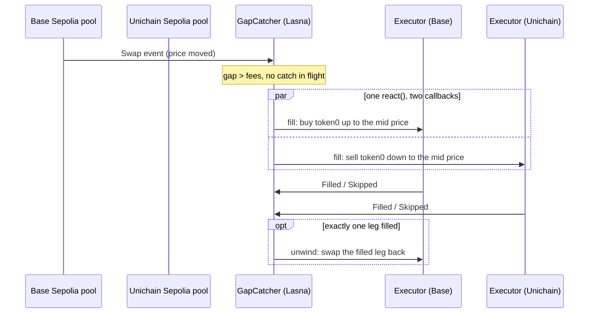

# Gap Catcher: a serverless cross-chain price keeper on Reactive Omni

**Gap → both legs filled: median 2.0 s, p90 3.0 s, n = 50** (live testnets, every tx hash in [`results/runs.jsonl`](results/runs.jsonl)).

A token team has the same pool on two Superchain L2s: Base and Unichain. When the two prices drift apart, someone has to buy on the cheap chain and sell on the dear one. Today that someone is a keeper bot: a server, two RPC connections and a hot key holding inventory.

Gap Catcher removes the bot. A reactive contract on Lasna watches both pools. When the gap is bigger than the fees, **one `react()` sends two callbacks at once**: it buys on the cheap chain and sells on the dear one, each up to the midpoint price. The executors report back, and if only one leg fills, the reactive contract unwinds it. The only place where both chains' state meets is the reactive contract.

Track: **Every Second Counts.**



## See it on chain

| Step | Catch #3 (both filled) | Unwind #2 (one leg gone) |
|---|---|---|
| Gap opened | [Base `0xfa68…`](https://sepolia.basescan.org/tx/0xfa6830c6b8826ba3b0f078578c049ec8daffc43f08ed6612b9207baf7b597675) | [Base `0x1345…`](https://sepolia.basescan.org/tx/0x13453ffc9a03a544b0ae15a4b615740727302008520a18ec5fe2a078d2f872e5) |
| One `react()`, two callbacks | [Lasna](https://lasna.reactscan.net/tx/0xd07627a2442383a7febe37fec18db3cfb011f1be90b4794f709734567e92a9e4) | [Lasna](https://lasna.reactscan.net/tx/0xb3703b1fe599344377645d796b8bd822f9711e2981c1c41918fd50f2e615e8a0) |
| Base leg | [filled +2.4 s](https://sepolia.basescan.org/tx/0x024acc6647b9f12f582d0ef33f6ae4f8f31d9819157c4525e06b144c9857651b) | [filled +2.2 s](https://sepolia.basescan.org/tx/0x66f4e3d474c636a0c082ec5516307f98c418fb387bd0b251ce980ee8b766a328) |
| Unichain leg | [filled +3 s](https://sepolia.uniscan.xyz/tx/0x6f8819dbc2afaa6d08c10a380fcf884877da253607d744a489f6ef29650f5585) | [skipped: price already gone +2.8 s](https://sepolia.uniscan.xyz/tx/0xe080043313d683b537b12ee645ace2957bee0405090b4bf12eaa3f2a955e39c3) |
| Unwind | n/a | [Base leg swapped back +4.4 s](https://sepolia.basescan.org/tx/0x74abcbff8d567e26e85abeb530d02e263eedf9a9aa9d1c1b8d219de72709789d) |

### Open a gap yourself

You need any Base Sepolia account with a little gas. The GapMaker mints its own test tokens, so you need nothing else.

```bash
cast send 0xE947233b632A660feF7B6C536202C0e9C1Ef9A7e "makeGap(bool,uint256)" true 20000000000000000000 \
  --rpc-url https://sepolia.base.org --private-key $YOUR_TESTNET_KEY
```

Within about 2-3 s, both executors trade: [Base executor](https://sepolia.basescan.org/address/0xb8d8fcbAcC7d40C088CD4Ef184DB5Baf6CfD7D73#events), [Unichain executor](https://sepolia.uniscan.xyz/address/0x721B1004531A793d29b696Bd0696930187873d69). Use `false` to push the price the other way. The Unichain button is the same call to `0x4cb9781B127C8D1A24a15DBd0793Ba14fa961e6f` on `https://sepolia.unichain.org`. A 1-token gap is below the fees and must not fire.

## Results

| Route | n | Both legs filled | Gap → both legs: p50 | p90 |
|---|---|---|---|---|
| **Gap Catcher on Reactive Omni** | 50 | 50 | **2.0 s** | **3.0 s** |
| Keeper bot we ran ourselves ([`baseline.py`](scripts/baseline.py)) | 23 | 23 | 2.8 s | 3.6 s |
| Bare loop, Base → Lasna → Base ([probe](scripts/probe_latency.py)) | 20 | 20 | 1.6 s | 2.2 s |
| Legacy Reactive, *modelled*, not measured | n/a | n/a | ~5 s | ~8 s |

- Spread of the 50 catches: p95 3.3 s, worst 4.0 s. The Base leg lands at p50 1.8 s and the Unichain leg at p50 2.0 s; the two legs land within p50 0.4 s of each other (max 1.0 s). Catch #1 was run by hand before the harness existed, and catch #9's log row was lost to an RPC error, though its events are on chain. Neither is counted.
- **Unwind:** 1 of 1 unwound. **Negative control:** 1 of 1 sub-fee gaps did not fire.
- **How latency is measured:** from the block that opened the gap to the block holding the last fill, using each chain's own block timestamps. Base headers carry `timestampMs`, so Base is exact to its 200 ms blocks. Unichain timestamps are whole seconds.
- **The keeper bot:** a typical, fair bot. It polls both pools at `latest` over the public RPCs, signs locally and sends both legs at once, with the same trigger, mid-price limit and size. It trades a separate twin pool pair (fee 0.05%) that Gap Catcher does not watch, so the two never compete. A tuned bot with websocket heads and Base flashblock preconfirmations would be faster than ours. The claim here is the same or better latency **with no server, no RPC bill and no hot key**, not that every bot is beaten.
- **Legacy, modelled:** no legacy Reactive network is left to measure; mainnet runs Omni and Kopli is down. The model replaces Lasna's measured ~1 s block with the documented ~7 s block, which adds 3 s on average and up to 6 s.

## Contracts

All are verified on Sourcify (`exact_match`). Addresses are in [`deployments.json`](deployments.json).

| Contract | Chain | Address |
|---|---|---|
| [`GapCatcher`](src/GapCatcher.sol): the reactive contract | Lasna 5318007 | [`0xBfA1c9CC4288f10B034B44C287B02108Aa45645f`](https://lasna.reactscan.net/address/0xBfA1c9CC4288f10B034B44C287B02108Aa45645f) |
| [`Executor`](src/Executor.sol) | Base Sepolia 84532 | [`0xb8d8fcbAcC7d40C088CD4Ef184DB5Baf6CfD7D73`](https://sepolia.basescan.org/address/0xb8d8fcbAcC7d40C088CD4Ef184DB5Baf6CfD7D73) |
| [`Executor`](src/Executor.sol) | Unichain Sepolia 1301 | [`0x721B1004531A793d29b696Bd0696930187873d69`](https://sepolia.uniscan.xyz/address/0x721B1004531A793d29b696Bd0696930187873d69) |
| [`GapMaker`](src/GapMaker.sol): the judge button | Base / Unichain | `0xE947233b632A660feF7B6C536202C0e9C1Ef9A7e` / `0x4cb9781B127C8D1A24a15DBd0793Ba14fa961e6f` |
| [`Token`](src/Token.sol) ×2: same CREATE2 address on both chains, so both chains share one PoolId | both | `0x517f19c3E341e535A0d7C6f46557EA4a96b550a1`, `0xEAb6B35c4E9fAD4d5aD8EFc8be604f442a74FbC6` |

The pools are the official Uniswap v4 deployments. PoolId `0xb930b476db0a7bc7234215f70def7803522303bbab65dc62313e59f2c82472eb` uses fee 0.3%, tick spacing 60 and full-range liquidity.

**GapCatcher in five rules** ([source](src/GapCatcher.sol)):
1. It subscribes to `Swap` on both PoolManagers, filtered to our PoolId, and to everything the two executors emit. It ignores logs older than the last one seen per chain.
2. **Firing:** it fires when the sqrt prices differ by more than `minGapSqrtBps` (50, about a 1% price gap against 0.6% of round-trip fees). No catch may be in flight, and a 5 s cooldown applies. Each leg is exact input, with the price limit at the midpoint, so **the pool sizes the trade** and no sizing math runs on chain.
3. **Lock:** a catch holds a lock until both executors report `Filled` or `Skipped`. A 60 s timeout covers a lost leg.
4. **Unwind:** if exactly one leg fills, it sends an unwind that swaps that leg's output back with no price limit, so the inventory returns to neutral.
5. It never reverts inside `react()`, and each callback carries 1,000,000 gas.

**Executor:** it checks that `msg.sender` is the Reactive callback proxy and that the injected first argument is our GapCatcher. If the deadline has passed or the price is already past the limit, it emits `Skipped` instead of reverting, so the loop always closes.

## Reproduce

```bash
git clone https://github.com/cyberhooman/reactive-omni-gap-catcher && cd reactive-omni-gap-catcher
git submodule update --init         # top level only; v4-core's own submodules are not needed
forge build
forge test                          # 12 tests: 8 GapCatcher unit tests (mock system contract), 4 Executor tests on a Base Sepolia fork
bash scripts/deploy.sh              # fresh deployment -> deployments.json (needs DEPLOYER_PRIVATE_KEY with testnet ETH + lREACT)
python scripts/runs.py catch 10     # closed-loop catches, appended to results/runs.jsonl
python scripts/runs.py unwind 1     # gap + simulated competitor -> one leg skips -> unwind
python scripts/runs.py control 1    # sub-fee gap, must not fire
python scripts/baseline.py 10       # the keeper-bot baseline
```

`lib/` holds git submodules pinned to the commits that were built and tested: reactive-lib-omni v0.1.0 (`3ade0dc`), v4-core main (`bea7f6d`) and forge-std v1.17.0.

## What is real and what is simulated

| Real | Simulated |
|---|---|
| Every contract runs on public testnets: Base Sepolia, Unichain Sepolia, Lasna (Omni) | The gaps come from our GapMaker: a 20-token swap moves the price ~4%. This is not organic flow yet |
| The official Uniswap v4 PoolManager and test routers | The tokens are open-mint test tokens, and the pools hold uniform full-range liquidity that we added |
| Every catch, skip and unwind is a tx hash; latency comes from chain timestamps | The "competitor" in the unwind run is our own second swap on the other chain |
| The keeper bot really ran against twin pools | The legacy-Reactive figure is modelled, because no legacy network is left |

**Not built (deliberately):** automatic inventory rebalancing between chains (executors are funded by hand) and mainnet. Professional searchers will win hot pairs. The user this is for is the long-tail token team that does not want to run a bot.

## Cost

One `react()` costs ~0.017 lREACT. A full catch is ~5 reactions (the gap swap, two fill swaps and two reports), about **0.08 lREACT per catch**. Callbacks on the L2s cost ~0.000001 ETH each.
